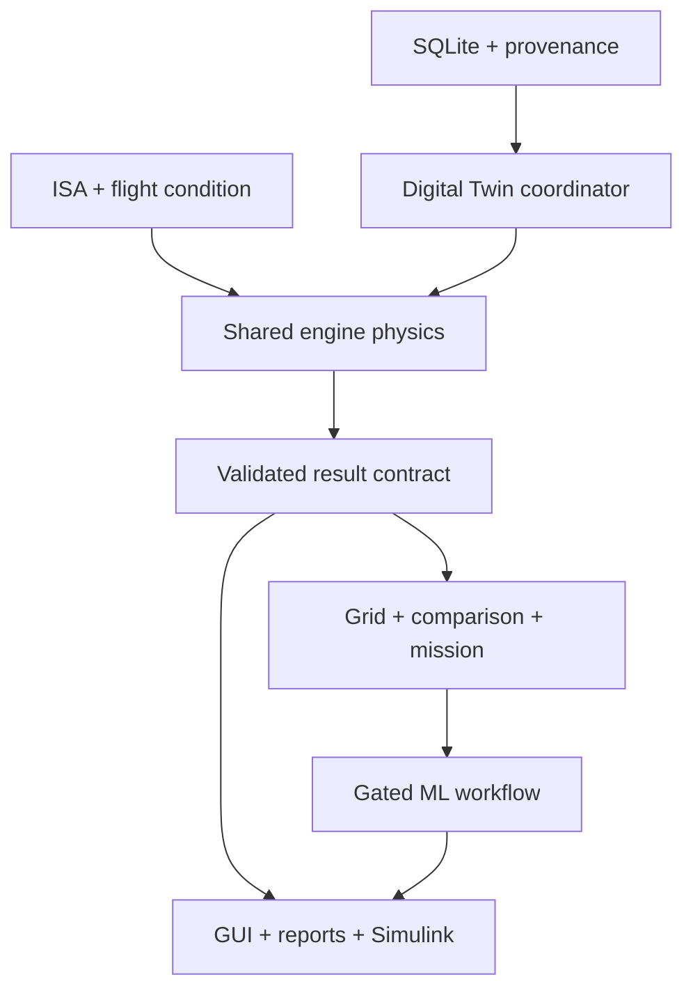

# Architecture and contracts

## One authoritative backend

Database rows load through DB_Interface and db_get_engine. The latter constructs an engine structure and checks matching numerical provenance. flight_condition standardizes altitude convention and SI conditions. simulate_engine validates the inputs and dispatches to Piston_Model, TJ_Model, TF_Model or TP_Model. Gas turbines share gas_turbine_cycle and its component functions. The coordinator, comparison, grids, mission logic, GUI and Simulink all call this same backend.

## Public interfaces

| Entry | Inputs | Output / side effect |
| --- | --- | --- |
| setup_project | Optional database path | Adds project folders; initializes and seeds compatible DB |
| flight_condition | Altitude m, Mach, throttle, optional convention/afterburner | Standard condition including geometric and geopotential altitude |
| ISA_model | Altitude m, Mach, convention | Static/total atmosphere, velocity, gravity and viscosity |
| db_get_engine | DB handle, Engine_ID | Parameters, provenance, architecture, warnings and fingerprint |
| simulate_engine | Engine structure, flight structure | Standard result; invalid evaluations carry Valid=false and diagnostics |
| DT_Coordinator.run | ID, condition, L1/L4/L5, persistence flag | Physics or accepted surrogate result |
| DT_Coordinator.sweep | ID, geopotential altitudes, Mach, throttle, persistence | L2 table, retaining invalid points |
| DT_Coordinator.map | ID, persistence | L3 architecture grid table |
| compare_engines | Coordinator, IDs, condition, metric | Comparable results and sorted metric table |
| EngineSelector | Coordinator, mission ID/structure, IDs, persistence | Feasible/eliminated candidates, reasons and contributions |
| validate_physics | Database path | Executed internal tests, Track A report, current acceptance certificates |
| ml_train_surrogates | Coordinator, ID, optional current dataset | Actual metrics and MAT bundles, only after validation gate |
| generate_report | Result, comparison, selection, ML metrics | HTML analysis report using available session evidence |

## Data contract

SI is authoritative: force N, pressure Pa, absolute temperature K, mass kg, fuel kg/s, shaft power kW, TSFC kg/(N s), BSFC kg/kWh, altitude m, efficiencies dimensionless. Fields are named with their units. Jet Thrust_N and propeller EquivalentThrust_N are distinguished; jet-only TSFC remains unavailable for turboprop/piston. ShaftPower_kW for a turboprop is power delivered after the gearbox. Station tables contain total temperature/pressure; nozzle diagnostics separately retain static exit quantities.

The result also carries Engine_ID, engine name/architecture, condition, Data_Type, Prediction_Source, confidence, validity, warnings, version/fingerprint and station/component diagnostics. NaN represents unavailable numerical values in MATLAB and becomes SQL NULL. Physical values are never silently substituted for missing values. A comparison rejects an incompatible metric instead of ranking unavailable values.

## Digital Twin levels

L1 is a single-point physics evaluation. L2 is an altitude sweep. L3 is the specified performance grid. L4 adds persistent results and logs. L5 attempts a current, accepted surrogate within its domain and explicitly falls back to physics if it is missing, stale or inapplicable. These levels describe software capability; they do not imply a sensor-connected or calibrated physical engine.

## Persistence and failure paths

Every connection enables foreign keys. The native SQLite interface uses typed table writes, a closed identifier list and AutoCommit off/commit/rollback for atomic operations. Trusted distributed schema/seed scripts are the only SQL text executed from files. Reference rows are immutable and simulation logs append-only. Invalid operating points are retained in evaluation tables and failure metadata; no nonphysical result is eligible for ML training. An unknown engine ID is logged with a NULL foreign key and the original ID in input metadata when persistence is requested.

The fingerprint covers current code and engine/provenance inputs. Changes invalidate stored validation and surrogate use. It is a consistency check, not a cryptographic signature or protection against deliberate alteration of a local workspace.

## Integration review limits

reports/HOST_AUDIT_RESULTS.json records the static dependency inventory, callback dispatch registry, filename uniqueness, entry-name matching and model references. MATLAB's scripts/audit_dependencies.m uses requiredFilesAndProducts on the actual installation to resolve toolbox dependencies. Dynamic callback dispatch and MATLAB API behaviour still require runtime tests; static text inspection cannot prove all variables, argument types or paths correct.
