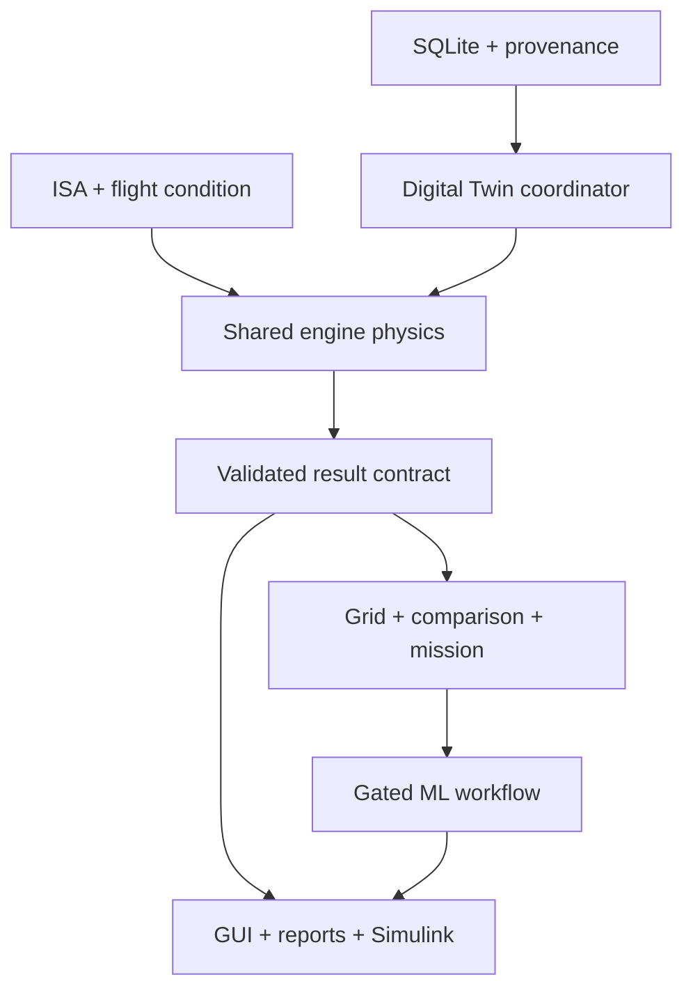

# ABACUS implementation technical report

Aircraft Engine Performance Analysis, Digital Twin, Machine Learning and Intelligent Engine Selection System

Version 1.0 | 16 September 2026

This report records the architecture, physical equations, provenance policy, implementation choices, testing plan and actual host evidence. It is not an experimental validation thesis. The final appendix contains the delivered MATLAB source for review and traceability; it is explicitly source documentation, not additional experiments.

# Aircraft Engine Digital Twin - ABACUS

Academic steady-state software Digital Twin for engine performance analysis, comparison, constrained mission selection and physics-based ML surrogates. This implementation follows the attached ABACUS v1.1 specification; every deliberate correction or scope extension is recorded in CHANGELOG.md.

## Delivery status

All 15 requested implementation areas have source, integration interfaces, documentation and relevant tests. **This is an implementation package awaiting MATLAB runtime acceptance, not a claim that all phases have passed.** The executed host audit passed 28 checks, including real SQLite schema, seed, transaction, provenance and integrity checks. The 64 MATLAB test functions have not been executed in this environment. MATLAB, GUI, Simulink and ML training results are not supplied as successful results.

The default database contains the PDF's 11 engines and 192 populated numerical parameters with matching provenance. All engine inputs copied from the secondary specification or introduced as assumptions retain Low confidence. No primary manufacturer data was independently verified during this implementation. Missing TSFC values remain NULL. The Kaveri warning is mandatory. Two optional piston entries implement the additional user request without changing the PDF's default catalogue.

## Requirements

- MATLAB R2023b or newer.
- Database Toolbox, for the native SQLite interface, sqlread and sqlwrite.
- Statistics and Machine Learning Toolbox for RF, GPR and ANN training. The ANN implementation uses fitrnet with a separate network for each output; Deep Learning Toolbox is not required.
- Simulink only for the three Simulink wrappers.
- A graphical MATLAB desktop for the eight-tab app. A JVM is used for SHA-256 fingerprints.

No Python, Node.js, external SQLite JDBC driver or network connection is needed to run the MATLAB application. The optional host auditor uses Node.js 24 or newer with its built-in SQLite module.

## Start

Unzip, open MATLAB, and set Current Folder to the extracted Aircraft_Engine_Digital_Twin directory. Then run:

```matlab
run_project('gui')
```

That command calls setup_project, adds the authoritative folders, checks MATLAB version, and initializes/seeds the database if necessary. Existing compatible data is preserved. The GUI is a programmatic AppBase application in gui/EngineAnalyser_v1.m; it is not an App Designer .mlapp Design View file.

For an explicit installation and acceptance sequence:

```matlab
p = setup_project;
db_initialize(p.database_file);
db_seed(p.database_file);
installation = verify_project;
tests = run_all_tests;
validation = run_project('validate');
app = run_project('gui');
```

Do not call a runtime phase accepted until its actual tests and reference review have been completed. Read FINAL_VERIFICATION_REPORT.md before presenting results.

## Reproducible workflows

```matlab
demo = run_project('demo');             % Single point, comparison, mission, HTML report
grid = run_project('grid');             % Architecture grids; may take time
db_seed_piston_extension;              % Explicitly add the two optional piston engines
models = run_project('simulink');        % Build actual .slx files with licensed Simulink
simout = run_simulink_model;            % Execute the turbojet wrapper
training = run_project('train');        % Requires accepted, current physics validation
```

The default ML gate is intentionally closed: the supplied secondary reference ratings are unverified. See docs/ML_WORKFLOW.md for the source-review and validation requirements. L5 falls back to physics with an explicit warning when an accepted model is unavailable. No pretrained MAT files, fabricated accuracy values, measured engine outputs or generated validation certificates are included.

## Structure

| Folder | Purpose |
| --- | --- |
| database | Reproducible SQL, production/test SQLite files, provenance and reference policy |
| matlab/setup | Native SQLite access, seeding, constants and typed persistence |
| matlab/atmosphere | Three-layer ISA with explicit altitude convention |
| matlab/engines | Common cycle components and piston/TJ/TF/TP adapters |
| matlab/validation | Input/output checks, reference validation, sensitivity and regression |
| matlab/digital_twin | Shared coordinator and architecture dispatch |
| matlab/performance | Architecture grids and validity-aware evaluation |
| matlab/comparison, matlab/mission | Comparisons and constraint-first mission scoring |
| matlab/ml | Dataset, splitting, four surrogate families, prediction and metrics |
| matlab/reporting, matlab/utilities | Tables, plots, HTML reports, paths and fingerprints |
| gui, simulink | Eight-tab app and three steady-state model wrappers |
| tests, scripts | MATLAB tests, phase runner, static/host audit tools |
| docs, reports | Manuals, technical report, specification and actual verification evidence |
| results, plots, tables, ml_models | Runtime output destinations; no invented results |

## Scope

Uninstalled, constant-property, separate-exhaust, steady-state models. No afterburner, compressor maps, transient dynamics, surge/stall, cooling/bleed, inlet distortion, detailed propeller map, flight-range solver, engine degradation, hardware interface or certification claim. Rated thrust/power is never used to force model outputs to match a target. Mission results compare catalogue candidates under an academic model and do not establish aircraft suitability.

See docs/USER_MANUAL.md, docs/ARCHITECTURE.md, docs/ASSUMPTIONS.md, docs/DATA_PROVENANCE.md, docs/TESTING.md and docs/LIMITATIONS.md. The PDF technical report includes a labelled source-code appendix, not experimental results.


# Architecture and contracts

## One authoritative backend

Database rows load through DB_Interface and db_get_engine. The latter constructs an engine structure and checks matching numerical provenance. flight_condition standardizes altitude convention and SI conditions. simulate_engine validates the inputs and dispatches to Piston_Model, TJ_Model, TF_Model or TP_Model. Gas turbines share gas_turbine_cycle and its component functions. The coordinator, comparison, grids, mission logic, GUI and Simulink all call this same backend.



## Public interfaces

| Entry | Inputs | Output / side effect |
| --- | --- | --- |
| setup_project | Optional database path | Adds project folders; initializes and seeds compatible DB |
| flight_condition | Altitude m, Mach, throttle, optional convention/afterburner | Standard condition including geometric and geopotential altitude |
| ISA_model | Altitude m, Mach, convention | Static/total atmosphere, velocity, gravity and viscosity |
| db_get_engine | DB handle, Engine_ID | Parameters, provenance, architecture, warnings and fingerprint |
| simulate_engine | Engine structure, flight structure | Standard result; invalid evaluations carry Valid=false and diagnostics |
| DT_Coordinator.run | ID, condition, L1/L4/L5, persistence flag | Physics or accepted surrogate result |
| DT_Coordinator.sweep | ID, geopotential altitudes, Mach, throttle, persistence | L2 table, retaining invalid points |
| DT_Coordinator.map | ID, persistence | L3 architecture grid table |
| compare_engines | Coordinator, IDs, condition, metric | Comparable results and sorted metric table |
| EngineSelector | Coordinator, mission ID/structure, IDs, persistence | Feasible/eliminated candidates, reasons and contributions |
| validate_physics | Database path | Executed internal tests, Track A report, current acceptance certificates |
| ml_train_surrogates | Coordinator, ID, optional current dataset | Actual metrics and MAT bundles, only after validation gate |
| generate_report | Result, comparison, selection, ML metrics | HTML analysis report using available session evidence |

## Data contract

SI is authoritative: force N, pressure Pa, absolute temperature K, mass kg, fuel kg/s, shaft power kW, TSFC kg/(N s), BSFC kg/kWh, altitude m, efficiencies dimensionless. Fields are named with their units. Jet Thrust_N and propeller EquivalentThrust_N are distinguished; jet-only TSFC remains unavailable for turboprop/piston. ShaftPower_kW for a turboprop is power delivered after the gearbox. Station tables contain total temperature/pressure; nozzle diagnostics separately retain static exit quantities.

The result also carries Engine_ID, engine name/architecture, condition, Data_Type, Prediction_Source, confidence, validity, warnings, version/fingerprint and station/component diagnostics. NaN represents unavailable numerical values in MATLAB and becomes SQL NULL. Physical values are never silently substituted for missing values. A comparison rejects an incompatible metric instead of ranking unavailable values.

## Digital Twin levels

L1 is a single-point physics evaluation. L2 is an altitude sweep. L3 is the specified performance grid. L4 adds persistent results and logs. L5 attempts a current, accepted surrogate within its domain and explicitly falls back to physics if it is missing, stale or inapplicable. These levels describe software capability; they do not imply a sensor-connected or calibrated physical engine.

## Persistence and failure paths

Every connection enables foreign keys. The native SQLite interface uses typed table writes, a closed identifier list and AutoCommit off/commit/rollback for atomic operations. Trusted distributed schema/seed scripts are the only SQL text executed from files. Reference rows are immutable and simulation logs append-only. Invalid operating points are retained in evaluation tables and failure metadata; no nonphysical result is eligible for ML training. An unknown engine ID is logged with a NULL foreign key and the original ID in input metadata when persistence is requested.

The fingerprint covers current code and engine/provenance inputs. Changes invalidate stored validation and surrogate use. It is a consistency check, not a cryptographic signature or protection against deliberate alteration of a local workspace.

## Integration review limits

reports/HOST_AUDIT_RESULTS.json records the static dependency inventory, callback dispatch registry, filename uniqueness, entry-name matching and model references. MATLAB's scripts/audit_dependencies.m uses requiredFilesAndProducts on the actual installation to resolve toolbox dependencies. Dynamic callback dispatch and MATLAB API behaviour still require runtime tests; static text inspection cannot prove all variables, argument types or paths correct.


# Physical assumptions and equation ledger

## Atmosphere

ISA is evaluated on geopotential altitude h from 0 to 32000 m. GUI altitude H is geometric. Convert h=Re*H/(Re+H), Re=6356766 m. Constants: T0=288.15 K, P0=101325 Pa, g0=9.80665 m/s2, R=287.058 J/(kg K), gamma=1.4. Lapse layers are -0.0065 K/m through 11 km, isothermal through 20 km, and +0.001 K/m through 32 km. Each layer's base pressure is propagated from the previous layer. Density=P/(R*T), sound speed=sqrt(gamma*R*T); total conditions use isentropic Mach relations. Gravity and Sutherland viscosity are included. No extrapolation or weather departure is automatic.

## Gas turbine stations

Turbojet stations are 0,2,3,4,5,8. Turbofans add fan exit 2.5 and bypass nozzle 18. Turboprops add free power-turbine exit 7. All tabulated station temperatures/pressures are total quantities. Fuel increases core gas mass through the combustor. A non-ideal convergent nozzle returns exit Mach, static pressure, area, velocity, choking state and pressure thrust; expanded-equivalent velocity is used only for the energy bookkeeping stated in code.

Compression: T_out=T_in*[1+(PR^((gamma-1)/gamma)-1)/eta_c]. Specific compressor work is cp_air*(T_out-T_in). Burner fuel-air ratio follows (cp_gas*T4-cp_air*T3)/(eta_b*LHV-cp_gas*T4), with positive denominator and temperature-rise checks. The gas-generator turbine supplies compressor plus fan demand through mechanical efficiency; turbine pressure follows the efficiency-consistent temperature relation. Net thrust sums exit momentum and pressure thrust and subtracts incoming air momentum. Fuel momentum at inlet is not added because onboard fuel has no separate incoming freestream flux.

cp is derived from each gas R and gamma; cp_air and cp_gas therefore need not equal the PDF's rounded independent constants. Cold gas: gamma=1.4, R=287.058. Hot gas: gamma=1.33, R=287.4. LHV for the core gas-turbine model is 43.2 MJ/kg.

## Off-design conditions

Throttle theta linearly reduces OPR toward 1 and fan PR toward 1. TIT is T3+theta*(design TIT-T3). Corrected inlet mass flow scales with total pressure/sqrt(total temperature), multiplied by 0.35+0.65*theta. Supersonic ram recovery uses 1-0.075*(Mach-1)^1.35, multiplied by the stored inlet recovery. These laws are labelled assumptions. The design mass-flow values do not supply compressor maps or a physically complete spool match. Low throttle below 0.5 is warned. Exactly zero throttle returns an engine-off result with zero output/fuel, no windmilling model and no fabricated fuel-specific consumption.

## Turbofan

The total inlet airflow divides into core=total/(1+BPR) and bypass=total-core. The fan acts on both streams. OPR denotes total fan-times-core compression, so core PR=OPR/fan PR. Turbine work per unit core air is compressor work+(1+BPR)*fan work. Separate core and bypass nozzles can choke independently. No mixer, afterburner or multi-spool map is supplied.

## Turboprop and propeller

After gas-generator work balance, a free power turbine expands to an assumed total pressure 1.05 times ambient. Its flow includes fuel mass. Shaft power passes through a stored gearbox efficiency. ShaftPower_kW is the delivered propeller-shaft power. Residual jet thrust is calculated from the actual remaining total pressure/temperature. Equivalent thrust equals propeller thrust plus residual jet net thrust. BSFC uses delivered shaft power.

At rest, ideal actuator-disc thrust scales as (2*rho*A)^(1/3)*(eta_prop*P)^(2/3). A smooth blend reaches eta_prop*P/V at Mach 0.05, using an algebraically finite expression at V=0. The propeller model is an academic static/cruise bridge, not a blade-element or measured propeller map. Diameter and RPM are explicit assumptions; tip Mach is diagnostic. ESHP=(P_prop+F_jet*V/eta_prop)/745.6998716, with powers in W.

## Optional piston model

Naturally aspirated airflow is rho*displacement*RPM/(30*strokes)*volumetric_efficiency*throttle. A four-stroke engine therefore has one intake per two revolutions. Fuel=air/AFR, brake power=fuel*LHV*brake_thermal_efficiency, torque=power/angular_speed. Compression ratio defines an ideal Otto efficiency bound; the supplied brake efficiency must remain lower. No manifold pressure map, supercharging, friction decomposition, transient combustion or manufacturer calibration is claimed. Both catalogue records and their parameters are opt-in Assumed/Low academic entries.

## Envelope and grid policy

Engine envelopes follow the PDF Table 18.5 academic domains. They are not aircraft operating approvals. Turboprop altitude is 9000 m despite the conflicting PW127G note of 7620 m. Turbojets and low-BPR fans use 21x9x6=1134 grid points; high-BPR fans and turboprops use 21x8x6=1008. High-BPR altitude knots include 10668 and 11000 m. Supersonic grid entries outside an engine's limit are retained as invalid and excluded from ML. Grid cardinality is a configured evaluation count, not a claim that all points are physically valid.

## Reference interpretation

Internal balance checks establish consistency of the implemented equations. Track A compares at matching source conditions, respecting dry/afterburner distinction and source-review status. Track B measures surrogate approximation to generated physics. Passing one track does not prove the other. Assumed mass flows and efficiencies may produce substantial errors against secondary ratings, especially in turboprop power; the implementation does not hide those errors by scaling outputs to ratings.


# Data provenance

The default seed is an explicitly labelled academic transcription of the user-provided ABACUS v1.1 blueprint, supplemented by disclosed assumptions. No engine parameter in this delivery was independently verified against its original manufacturer/type-certificate source. An engine name or a citation appearing in the blueprint is not itself primary-source verification.

The engine catalogue contains:

| ID | Engine | Architecture | Confidence |
| --- | --- | --- | --- |
| 1 | J79-GE-17A | Turbojet | Low |
| 2 | SNECMA Atar 9C | Turbojet | Low |
| 3 | R-25-300 | Turbojet | Low |
| 4 | CFM56-5B4 | Turbofan_HighBPR | Low |
| 5 | CF6-80C2B1F | Turbofan_HighBPR | Low |
| 6 | F100-PW-229 | Turbofan_LowBPR | Low |
| 7 | SNECMA M88-2 | Turbofan_LowBPR | Low |
| 8 | GTX-35VS Kaveri | Turbofan_LowBPR | Low |
| 9 | PT6A-67D | Turboprop | Low |
| 10 | PW127G | Turboprop | Low |
| 11 | AE 2100D3 | Turboprop | Low |

Every one of the 192 populated numerical core engine parameters has a Parameter_Provenance record whose value matches the parameter table, with unit, source category, reference, notes and confidence. Estimated means a secondary/transcribed academic value; Assumed means an explicit modelling assumption. Neither means measured. The 13 Performance_Data reference rows include excluded afterburning targets for traceability; they are all UnverifiedSecondary with Reference_Verified=0. Missing measured TSFC is NULL, not an invented zero or fitted number. Defaults remain Low confidence in derived outputs.

The optional seed adds Lycoming O-360-A1A and Continental IO-550-B. The user requested their inclusion, but the primary PDF's core does not include pistons. Their supplied numerical values are explicit academic assumptions and not manufacturer-confirmed specifications.

## Source-review process

Read the original public source and verify the exact variant, configuration, dry/afterburning status, altitude convention, atmospheric condition, Mach, throttle/rating, units and measurement/rating status. Record its exact URL, title/page, conversions and reviewer note. db_add_reference appends a new immutable row after these explicit inputs; it records the caller's review, not an automated independent verification. Do not update or delete an old reference to erase a discrepancy.

Reference_Kind is Measured, PublishedRating or EstimatedTarget for newly reviewed inputs. EstimatedTarget retains Low confidence and the statement that it is not measured performance. Kaveri accepts only EstimatedTarget under this project policy. Re-run validate_physics, inspect actual errors and the applicable tolerance, then inspect each engine's fingerprinted certificate. A reviewed source alone does not make an inaccurate model pass.

## Confidence and labels

Reference identifies the origin of a comparison target, not its truth. Simulated is reserved for physics data without estimated parameter status; supplied Low-confidence seeds produce Simulated_Estimated. ML_Predicted marks surrogate outputs while retaining underlying source confidence and the surrogate's actual validation metadata. The L5 prediction source is always visible; a fallback remains Physics.

Kaveri displays: ESTIMATED / ACADEMIC MODEL - NOT MANUFACTURER-CONFIRMED PERFORMANCE. These results do NOT represent actual Kaveri engine performance.

## Reference conflicts retained

CF6 variant naming, PT6A power, AE2100 rounding, PW127 altitude, Kaveri dry/afterburner targets and atmosphere checkpoints are resolved in CHANGELOG.md. Preserve these notes when adding stronger sources. Parameter changes must update matching provenance and trigger revalidation; do not silently promote a confidence flag.


# SQLite database

engine_analysis.db is the seeded application database; engine_test.db is a separate seeded inspection copy. Automated MATLAB tests create disposable databases and do not mutate the production catalogue. schema.sql and seed_data.sql reproduce the 11-engine core. seed_piston_extension.sql is optional. PRAGMA user_version is 2.

The 11 required tables are Manufacturers, Engine_Types, Engines, Engine_Thermo_Params, Parameter_Provenance, Aircraft, Engine_Aircraft_Map, Performance_Data, Mission_Profiles, References and Simulation_Log. Project_Metadata is an additional table. Three views expose catalogue, reference rows and joined provenance; three indexes support condition/provenance/log lookups. Foreign keys are explicitly enabled on every connection. CHECK constraints guard architecture parameters, efficiencies, enum values, flight conditions and mission weight sum. Triggers make Reference rows immutable and Simulation_Log append-only.

Recreate in a new filename with setup_project(newDatabaseFile), or use db_initialize followed by db_seed. Both seed scripts are idempotent. Existing database files are never automatically deleted; an incompatible schema raises an error. No destructive migration utility is included.

The distributed SQL scripts use -- @statement delimiters so complete trigger bodies remain intact when MATLAB executes statements. Runtime values travel through typed sqlwrite tables; they are not concatenated into SQL. MATLAB NaN numeric data maps to SQLite NULL. The host SQL quoting test uses Node prepared bindings and therefore does not substitute for executing MATLAB sqlwrite tests.

The delivered databases have 11 engines, 192 numerical provenance records, 13 unverified secondary reference rows, 7 mission presets, 11 aircraft records and 11 engine-aircraft mappings. There are no supplied simulated or ML-predicted performance rows. Aircraft mappings are secondary catalogue associations, not flight suitability evidence.

See ../docs/DATA_PROVENANCE.md before interpreting a reference or changing an engine input.


# Machine-learning workflow

## Gate and data generation

The surrogate learns the implemented physics, not measured engine behaviour. ml_generate_dataset requires an accepted current validation certificate and uses the architecture grid through the authoritative coordinator. Invalid points, nonfinite targets and inappropriate fuel-consumption fields are excluded. The full validity mask is retained to reject prediction through invalid holes. The dataset is labelled Physics-generated synthetic data.

All default secondary targets are unverified, so no engine is automatically approved for ML. First execute validate_physics, inspect internal test results and Track A, review independent reference inputs as documented in DATA_PROVENANCE.md, resolve genuine model errors, then re-run validation. An explicitly reviewed estimated target only establishes agreement with an academic target. There is no bypass flag and no fabricated acceptance certificate in the distribution.

## Split and preprocessing

Features are Mach, geopotential altitude and throttle. Random seed is 42; prior RNG state is restored. The split is jointly stratified in Mach/altitude bins with approximate 70/15/15 allocation. Integer rounding within bins means exact global percentages can differ and are recorded. Duplicate input rows are rejected before splitting. Input and response scales are estimated exclusively from training rows. Validation and test rows are transformed using those training statistics.

## Candidate families

| Family | Candidates | Notes |
| --- | --- | --- |
| Polynomial | Degree 3 or 5 with ridge regularization | Shared explicit polynomial-feature generator |
| RF | 100 or 200 regression trees | Separate ensemble per target |
| GPR | Two kernel settings | Separate Gaussian process per target |
| ANN | Two fitrnet layer configurations | Separate network per target, compatible with R2023b |

Hyperparameter choice within a family and family selection use validation relative RMSE only. Family selection is frozen before test metrics are inspected. The selected family is not retroactively replaced by a better test score. Test results are reported for each family, while deployment acceptance additionally checks actual accuracy and single-point timing.

## Metrics and acceptance

RMSE and MAE retain the target's SI unit. R2 is undefined (NaN) for constant targets. MAPE excludes near-zero true targets and reports its included sample count. Relative errors normalize by mean absolute reference output. Criteria are R2 >=0.95, relative RMSE <2%, relative MAE <1.5%, MAPE <5%, plus measured single-point latency below 10 ms for operational use. These are thresholds, not delivered achievements. No R2 or latency is reported as achieved until training runs.

The test set evaluates approximation of the implemented physics only. It does not establish agreement with real engine data, uncertainty calibration or safety. Dense grid splits can be easier than extrapolation; the operational predictor disallows extrapolation.

## Artifacts and prediction

After execution, ml_models stores actual engine_ID_FAMILY.mat and engine_ID_best.mat bundles with trained objects, architecture, targets/features, fingerprint, validation score, grid/mask, test metrics, actual split, timing acceptance and timestamp. Reports include selection diagnostics, residuals and predicted-versus-physics plots. ml_learning_curve is an additional training-size study; it also retains the gate and is not precomputed.

ml_predict verifies architecture, current fingerprint, operational acceptance, input bounds and the validity of surrounding grid corners. Missing, stale, rejected or out-of-domain bundles cause an explicit physics fallback through DT_Coordinator L5. The interface does not silently turn a physics fallback into an ML prediction. No trained MAT bundle is supplied because MATLAB training was unavailable.

```matlab
setup_project;
validation = validate_physics;
% Review Track A and source inputs before continuing.
dt = DT_Coordinator;
data = ml_generate_dataset(dt,4);
metrics = ml_train_surrogates(dt,4,data);
delete(dt);
```

The last two commands intentionally raise a validation-required error for the unreviewed default seed.


# User manual

## Installation and first use

Extract the archive into a writable folder. In MATLAB R2023b or newer, set Current Folder to Aircraft_Engine_Digital_Twin. Install Database Toolbox. Run setup_project, verify_project and run_all_tests. The test runner writes actual Passed/Failed/Incomplete columns to reports/matlab_test_results.csv. Optional toolbox or desktop limitations may produce incomplete tests, which are not passes. Run run_project('gui') to open the application.

The first setup call preserves the provided seeded database and adds only the authoritative project source folders. You can create a separate database with setup_project(fullfile(tempdir,'my_abacus.db')). To use it in subsequent workflows, pass its filename explicitly to DT_Coordinator or EngineAnalyser_v1; calling run_project uses the standard project database.

## Eight application tabs

1. Engine Database Browser: select architecture/engine, inspect catalogue and per-parameter provenance. Source confidence appears with the selected engine.
2. Single-Point Analysis: enter geometric altitude in metres, Mach and throttle. Run physics at L4 or request L5. Inspect SI/display metrics, source label, warnings and station total conditions. No output exists before calculation.
3. Performance Envelope: generate altitude/Mach/throttle sweeps and architecture maps. Invalid cells remain flagged. Plot force, power or fuel metrics only where applicable.
4. Digital Twin Comparison: compare engines at a common flight condition and with one comparable metric. Jet TSFC and propeller BSFC are not interchangeable.
5. ML Surrogate Manager: generate gated data, train candidates and inspect actual metrics. Missing validation or unavailable models produces an actionable diagnostic.
6. Mission-Based Engine Selection: choose a preset or edit constraints and normalized weights, apply filtering, then inspect survivors, eliminations and score contributions.
7. Validation Report: execute physics tests and Track A comparison. Unverified secondary ratings remain WARNING. No table is preloaded with invented passes.
8. Settings and Export: change a compatible database, choose single-point SI/Imperial display, export CSV/MAT/PNG/PDF and create an HTML session report. GUI altitude entry and CSV remain SI.

The GUI calls backend functions; it contains no second implementation of the thermodynamic equations. It is provided as .m AppBase source and cannot be opened as a .mlapp in App Designer Design View. Runtime screen layout and callbacks still require desktop MATLAB acceptance.

## Command-line example

```matlab
setup_project;
dt = DT_Coordinator;
f = flight_condition(0,0,1);
r = dt.run(4,f,'L4',true);
disp(format_result_metrics(r,'SI'));
comparison = compare_engines(dt,[4,5],f,'Thrust_N');
mission = EngineSelector(dt,1,[],true);
reportFile = generate_report(r,comparison,mission,table());
delete(dt);
```

Check r.Valid and r.Warnings before interpreting a calculated metric. L1 can evaluate without persistence; L4 stores results and metadata. L5 attempts ML and labels any physics fallback. A separate engine-off convention applies at throttle zero.

## Mission presets

| Mission_ID | Mission_Name | Architectures | Altitude_m | Mach | Ceiling_m |
| --- | --- | --- | --- | --- | --- |
| 1 | Subsonic Commercial Transport | Turbofan_HighBPR | 11000 | 0.82 | 11000 |
| 2 | Air Superiority Fighter | Turbojet,Turbofan_LowBPR | 12000 | 1.2 | 12000 |
| 3 | Ground Attack / CAS | Turbojet,Turbofan_LowBPR | 5000 | 0.85 | 5000 |
| 4 | Maritime Patrol / ISR | Turboprop | 3000 | 0.45 | 3000 |
| 5 | STOL Transport | Turboprop | 2000 | 0.35 | 2000 |
| 6 | High-Altitude Reconnaissance | Turbojet,Turbofan_LowBPR | 20000 | 0.8 | 20000 |
| 7 | Academic Trainer | Turboprop | 1500 | 0.25 | 1500 |

The six PDF presets plus Trainer are academic screening examples. First apply architecture, flight-envelope, thrust/power, fuel-specific-consumption, weight and ceiling constraints. Only survivors are normalized and scored. An engine violating a hard condition cannot win. If no engine survives, the application says so; if exactly one survives, it reports feasibility without pretending a relative ranking. Identical criterion values score 0.5 and cannot distinguish candidates. Explanations show five weighted contributions. No aircraft drag, range or full mission fuel integration is included.

## Optional piston workflow

```matlab
setup_project;
db_seed_piston_extension;
app = run_project('gui');
```

The opt-in seed adds two Assumed/Low catalogue records. This is an extension to the PDF's 11-engine core. Use shaft power, BSFC, fuel flow and equivalent propulsive thrust for this architecture.

## Simulink workflow

```matlab
setup_project;
models = build_simulink_models;
out = run_simulink_model('ABACUS_Turbojet',[1;0;0;1]);
```

Input order is engine ID, geometric altitude m, Mach, throttle. The builder makes three connected .slx models, each with a constant operating point, Level-2 MATLAB S-function and workspace sink. The S-function calls the shared physics backend. Delivered .mdl files can be inspected before building. Stop time zero represents one equilibrium evaluation; running a longer Simulink time does not add engine dynamics. Close an existing model before rebuilding; the builder refuses to overwrite an open model's unsaved edits.

## Reporting and output locations

run_project('demo') creates a session report from real calculations once MATLAB runs. plots holds exported figures, tables contains CSV grids/analysis, results contains saved sessions and ml_models contains actual trained bundles. reports holds verification evidence and reports. The supplied technical report documents the implementation and includes source listings; it contains no claimed engine validation or experimental findings.

## Troubleshooting

If sqlite is unavailable, install/enable Database Toolbox. A release error requires R2023b or later. A schema error requires backing up the old database and deliberately migrating or choosing a new filename; do not delete a user's database blindly. A provenance error means a numerical parameter and its provenance are missing or inconsistent. A validation-required error is expected for ML with the default unverified references. A missing model warning during L5 results in physics fallback. Invalid operating points must be corrected or left invalid, not clipped into a different condition. If a Simulink wrapper fails, inspect the original backend diagnostic and run its corresponding MATLAB case first.


# Testing and verification

## Executed evidence

The host audit uses Node.js built-in SQLite and static source inspection. Its recorded runtime is Node.js v24.19.0; timestamp 2026-09-16T01:46:16.330Z. It passed 28 checks and failed 0. This does not run MATLAB code. The actual evidence is reports/HOST_AUDIT_RESULTS.json.

| Check | Status |
| --- | --- |
| Fresh schema and seed execute | PASS |
| Eleven core engines | PASS |
| Required tables, metadata, views and indexes | PASS |
| Reproducible idempotent seed | PASS |
| Foreign keys explicitly enabled | PASS |
| Foreign-key violations rejected | PASS |
| Database integrity and FK checks | PASS |
| Every numeric parameter has matching provenance and unit | PASS |
| No unverified manufacturer/type-certificate claims | PASS |
| Kaveri provenance remains Low/Estimated or Assumed | PASS |
| Missing TSFC not fabricated | PASS |
| All four data types accepted, invalid enum rejected | PASS |
| Reference records immutable | PASS |
| Simulation log append-only | PASS |
| Transaction rollback | PASS |
| Quoted text survives prepared-value roundtrip | PASS |
| Efficiency, OPR and mission weight constraints | PASS |
| Six PDF missions plus requested Trainer | PASS |
| Optional piston seed is separate and reproducible | PASS |
| Delivered engine_analysis.db integrity | PASS |
| Delivered engine_test.db integrity | PASS |
| Unique public MATLAB filenames | PASS |
| No forbidden unfinished implementation markers | PASS |
| No hardcoded author workspace paths in MATLAB | PASS |
| MATLAB source entry names match filenames | PASS |
| GUI dispatched action registry has handlers | PASS |
| Simulink wrapper and model references exist | PASS |
| Regression and ML gates are implemented | PASS |

## MATLAB tests included, not executed here

There are 64 test functions across eight suites. Fixtures create separate temporary databases. Optional GUI, Simulink or toolbox prerequisites are treated as incomplete/skipped tests, not passes. No matlab_test_results.csv is shipped because there was no MATLAB test run.

### TestAtmosphere.m

- testSeaLevel
- testGeopotentialCheckpoints
- testLayerContinuity
- testGeometricConversion
- testMachStagnation
- testNegativeAltitude
- testUpperBound
- testInvalidMachAndThrottle

### TestDatabase.m

- testAllTablesAndEngines
- testSeedIdempotent
- testProvenanceAudit
- testForeignKeyFailure
- testLiteralTextRoundTrip
- testAtomicRollback
- testImmutableReference
- testMissingProvenanceRejected
- testInvalidEngineID
- testSchemaConstraints

### TestEngines.m

- testIdealCompressionCheckpoint
- testNozzleChoked
- testNozzleUnchoked
- testNozzleBoundaryContinuity
- testNoExpansionRejected
- testAllCoreEnginesSLS
- testTurbofanMassAndFanDemand
- testTurbopropPowerAndStaticCase
- testPropellerContinuousAndFinite
- testKaveriWarningAndType
- testAltitudeAndMachEnvelope
- testAfterburnerRejected
- testBadEfficiencyAndTemperature
- testPistonPowerTorqueAndAltitude
- testZeroThrottleState
- testChangedParametersInvalidateFingerprint

### TestGUI.m

- testEightTabsAndKaveriWarning

### TestIntegration.m

- testPersistenceAndLog
- testFailedPointLogsWithoutPerformance
- testLogImmutable
- testArchitectureGridCounts
- testGridValidityMaskAndTemperatureFields
- testCompatibleComparison
- testIncompatibleComparisonRejected
- testAllMissionPresets
- testUnverifiedReferencesCannotPass
- testReportingContainsProvenance
- testOutputUnitConversion
- testHTMLTextEscaped

### TestML.m

- testSplitDeterministicAndDisjoint
- testDuplicateInputsRejected
- testMetricsKnownErrors
- testConstantAndZeroTargets
- testPolynomialTrainPredict
- testFourCandidateAPIs
- testMLCellRejectsHolesAndExtrapolation
- testMissingModelAndGate

### TestMission.m

- testNormalisationDirections
- testTieAndSingleMetric
- testAllEliminated
- testOnlyOneSurvives
- testHighScoreCannotOverrideConstraint
- testArchitectureAndCeiling
- testWeightsRejected
- testMixedSFCRejected

### TestSimulink.m

- testBuiltModelsMatchBackend

## Run in MATLAB

```matlab
setup_project;
installation = verify_project;
results = run_all_tests;
phaseResults = run_phase_tests(7);
dependencies = audit_dependencies;
validation = validate_physics;
```

Review every Failed and Incomplete result. A source parser cannot verify toolbox licensing, native SQLite types, GUI layout or S-function execution. The phase runner reuses meaningful suites instead of creating duplicate implementation-mirroring tests. For complete acceptance use run_all_tests, not only a single phase suite.

## Reference and regression checks

Track A compares exact reference conditions and reports real discrepancies without fitting. Unverified sources cannot receive PASS. Reviewed estimated targets remain explicitly academic. Track B reports real held-out surrogate error after training. regression_baseline('capture') requires passing internal tests and refuses to replace an existing baseline; regression_baseline('compare') uses a 0.01% relative-change threshold. A baseline is an executed software-regression artifact, not an independent engine measurement. parameter_sensitivity varies explicit model inputs and reports changes without claiming experimental uncertainty.

## Optional host reproduction

```bash
node scripts/audit_host.mjs .
```

Requires Node.js 24+. Its prepared-value roundtrip checks SQL/storage semantics through Node; the separate MATLAB typed-value roundtrip test must still execute with Database Toolbox.


# Limitations and unresolved acceptance work

1. MATLAB R2023b, Database Toolbox, Statistics and Machine Learning Toolbox, graphical app execution and Simulink were unavailable on the delivery host. Source parsing and native host SQLite checks cannot establish that those APIs execute correctly. All 64 MATLAB tests remain unexecuted here.
2. Engine data is Low-confidence secondary/assumed input. There are no independently verified manufacturer measurements in the supplied seed. Track A reference acceptance and all runtime output accuracy remain unresolved.
3. ML training is blocked until actual internal tests and reviewed in-tolerance reference comparisons produce a current certificate. No trained model, R2, RMSE, MAPE, timing or predicted performance is delivered as an experimental result.
4. The GUI is programmatic AppBase source, not a .mlapp Design View project. Its eight-tab layout and backend wiring need runtime desktop review. Source inspection is not a GUI walkthrough.
5. Three text .mdl wrappers and the .slx builder are delivered. .slx generation and model loading/running have not occurred. The wrappers provide steady-state shared-backend evaluations, no physical transient dynamics or code generation support.
6. Constant gas properties, assumed efficiencies/TIT/flow, algebraic throttle laws and fixed corrected-flow scaling exclude detailed component-map matching. Afterburners, variable geometry, cooling and bleed, surge/stall, installation losses, nozzle area schedules, emissions and combustion chemistry are absent.
7. Propeller static blending and residual-jet pressure allocation are explicit academic assumptions. They do not model a complete propeller map. Turboprop rating agreement must be checked; secondary mass flow and TIT can yield substantial excess predicted power.
8. Piston modelling is an optional, naturally aspirated extension with assumed parameters. It is not a manufacturer dynamometer map.
9. Mission selection is relative to feasible database entries and selected weights. Envelope ceiling is a model input; it is not an aircraft service ceiling. No drag, takeoff distance, payload/range, flight-path integration or airframe installation compatibility is solved.
10. Confidence flags are categorical provenance labels, not quantified uncertainty. Fingerprints detect changes for reproducibility, not malicious modification. The database is a local academic store, not a multi-user access-control service.
11. Dynamic HTML reports and static PDF documentation are included. A comprehensive thesis with real experimental validation, benchmark plots or trained-model results cannot be completed without those experiments. The technical PDF's source appendix is explicitly labelled.
12. Source and documentation are ready to place in a Git repository, but no remote repository, fabricated commit history or publication was created.

Do not treat host audit PASS as acceptance of all implementation phases. FINAL_VERIFICATION_REPORT.md lists each phase separately and identifies what was actually executed.


# Changelog

## Implementation 1.0 - 2026-09-16

The 77-page ABACUS v1.1 PDF remains the primary specification. The two uploaded PDF copies are byte-identical; one is retained in docs. The implementation adds the following explicit clarifications/corrections.

| ID | Issue | Implemented decision and consequence |
| --- | --- | --- |
| C01 | The blueprint illustrates JDBC parameter markers; the requested stack also allows native SQLite. | Use Database Toolbox native sqlite, allowlisted table identifiers, typed sqlread/sqlwrite, and MATLAB-side filtering. No user value is interpolated into SQL. This is not a claim to implement JDBC prepared-query APIs. |
| C02 | Earlier schema lists three data classes; later corrections require four. | Reference, Simulated, ML_Predicted and Simulated_Estimated are all constrained values. |
| C03 | The PDF contains geometric/geopotential atmosphere values and pressure checkpoints that do not consistently follow its equations. | Internal geopotential altitude, explicit conversion at the GUI, R=287.058 J/(kg K), and continuous layer equations. At 15 km geopotential the pressure is about 12045 Pa, not 12111; at 25 km about 2511 Pa, not 2549. The geometric/geopotential difference at 32 km is about 0.5%, not 0.16%. |
| C04 | Stated cp, gamma and R values are not fully thermodynamically consistent. | Derive cp=gamma*R/(gamma-1) for each constant-property gas. Results can therefore differ from arithmetic using rounded independent cp. |
| C05 | Turbofan work expression multiplies fan specific work by cp again. | Fan Work_Jkg already contains cp. Demand per kg core air equals compressor work plus (1+BPR)*fan work. |
| C06 | Non-ideal nozzle and choking equations need a consistent sonic boundary. | Derive the efficiency-adjusted sonic pressure ratio; retain the classical ratio at eta=1. Compute exit total pressure from actual exit static state and Mach. |
| C07 | Turboprop energy/momentum expressions omit fuel mass in places. | Use gas mass flow = core air*(1+fuel-air ratio) for turbine power and nozzle momentum. |
| C08 | Setting power-turbine exit total pressure equal to ambient removes the pressure head for a residual nozzle. | An explicit assumed back-pressure ratio of 1.05 permits residual jet expansion. This is a modelling choice, not a manufacturer parameter. |
| C09 | Propeller eta*P/V is singular at zero flight speed. | Use an actuator-disc static limit with a smooth blend to the cruise expression by Mach 0.05. Retain the propeller geometry assumption in provenance. |
| C10 | The printed ESHP expression places propeller efficiency inconsistently. | ESHP=(propeller-shaft power + residual thrust*speed/eta_propeller)/745.6998716. Static residual thrust contributes zero equivalent power. |
| C11 | Throttle and off-design compressor behaviour are underspecified. | Document explicit pressure-ratio, temperature-rise and corrected-flow laws; these are academic assumptions, not compressor maps. Zero throttle uses an engine-off convention. |
| C12 | Catalogue variants/ratings conflict within the PDF. | Use CF6-80C2B1F label; PT6A-67D 1119 kW from later Table 23 rather than 895; AE2100D3 3458 kW rather than 3459. All remain unverified secondary values. Kaveri uses the 53400 N estimated dry target, not the 81000 N afterburning target. |
| C13 | User requests piston engines, but the PDF final core is 11 gas turbines. | Provide a separate opt-in two-engine piston seed and model. Default catalogue remains the PDF's 11 engines. |
| C14 | User requests a Trainer mission in addition to the PDF presets. | Preserve six PDF presets and add an explicitly academic Trainer preset. |
| C15 | Desktop binary .mlapp cannot be generated/validated here. | Deliver a complete programmatic AppBase .m application with eight tabs and shared backend callbacks. App Designer Design View editing is not delivered. |
| C16 | MATLAB/Simulink is absent on the execution host. | Deliver three text .mdl models plus a real .slx builder and execution test. No generated .slx, claimed execution or fake binary is supplied. |
| C17 | Primary engine sources were not independently established. | All seed engine parameters stay Estimated/Assumed and Low, all secondary reference rows stay unverified. Training requires actual internal tests plus a reviewed in-tolerance reference/explicit estimated target. |
| C18 | A reviewed estimate must not be called measured validation. | Reference_Kind separates Measured, PublishedRating and EstimatedTarget from UnverifiedSecondary. Kaveri can only use EstimatedTarget. Acceptance against an estimate remains academic. |
| C19 | A repository history cannot be recovered/generated honestly from files. | Deliver GitHub-ready source, license and ignore rules without fabricated commits or publication. |

No reference rating is used to tune the engine equations. No numerical validation result, accuracy, timing, GUI screenshot or trained model is fabricated.


# Phase traceability

Statuses distinguish implementation from execution. No entire physics, ML or GUI phase is marked PASS based on source presence.

| Phase | Area | Status |
| --- | --- | --- |
| 1 | Database and project infrastructure | PASS for executed host SQL subchecks; WARNING for phase acceptance |
| 2 | ISA atmosphere | NOT EXECUTED |
| 3 | Piston physics | NOT EXECUTED |
| 4 | Turbojet physics | NOT EXECUTED |
| 5 | Turbofan physics | NOT EXECUTED |
| 6 | Turboprop physics | NOT EXECUTED |
| 7 | Physics validation and automated testing | WARNING |
| 8 | Digital Twin coordinator | NOT EXECUTED |
| 9 | Performance grids | NOT EXECUTED |
| 10 | Comparison and analysis | NOT EXECUTED |
| 11 | Mission-based selection | NOT EXECUTED |
| 12 | ML dataset generation | NOT EXECUTED |
| 13 | ML surrogate training and evaluation | NOT EXECUTED |
| 14 | MATLAB GUI | NOT EXECUTED |
| 15 | Full integration and reports | WARNING |

## PHASE 1 - Database and project infrastructure

**Status: PASS for executed host SQL subchecks; WARNING for phase acceptance**

Files: `setup_project.m`, `project_paths.m`, `matlab/setup`, `database/schema.sql`, `database/seed_data.sql`, `database/engine_analysis.db`, `database/engine_test.db`.

Dependencies: MATLAB R2023b, Database Toolbox.

Included test suites: TestDatabase.m.

Actually executed / reviewed: 28 host audit checks include real SQLite creation, seed, constraints, rollback, provenance and delivered-file integrity. MATLAB native connection/write APIs are NOT EXECUTED.

Known limitations and unresolved issues: Native SQLite typed operations replace JDBC-specific examples. Runtime API acceptance remains open.

Test cases in the applicable shared suites:

- TestDatabase.m: testAllTablesAndEngines, testSeedIdempotent, testProvenanceAudit, testForeignKeyFailure, testLiteralTextRoundTrip, testAtomicRollback, testImmutableReference, testMissingProvenanceRejected, testInvalidEngineID, testSchemaConstraints.

## PHASE 2 - ISA atmosphere

**Status: NOT EXECUTED**

Files: `matlab/atmosphere/ISA_model.m`, `matlab/utilities/flight_condition.m`.

Dependencies: project_config.

Included test suites: TestAtmosphere.m.

Actually executed / reviewed: Static source review only. No MATLAB atmosphere results were executed.

Known limitations and unresolved issues: Geometric/geopotential convention and inconsistent blueprint checkpoints are explicitly corrected.

Test cases in the applicable shared suites:

- TestAtmosphere.m: testSeaLevel, testGeopotentialCheckpoints, testLayerContinuity, testGeometricConversion, testMachStagnation, testNegativeAltitude, testUpperBound, testInvalidMachAndThrottle.

## PHASE 3 - Piston physics

**Status: NOT EXECUTED**

Files: `matlab/engines/piston/Piston_Model.m`, `database/seed_piston_extension.sql`, `matlab/setup/db_seed_piston_extension.m`.

Dependencies: Phase 1, Phase 2, propeller_model.

Included test suites: TestEngines.m.

Actually executed / reviewed: Host SQL check confirmed optional seed yields 13 engines. MATLAB physics was not executed.

Known limitations and unresolved issues: Opt-in extension outside PDF core; assumed naturally aspirated parameters.

Test cases in the applicable shared suites:

- TestEngines.m: testIdealCompressionCheckpoint, testNozzleChoked, testNozzleUnchoked, testNozzleBoundaryContinuity, testNoExpansionRejected, testAllCoreEnginesSLS, testTurbofanMassAndFanDemand, testTurbopropPowerAndStaticCase, testPropellerContinuousAndFinite, testKaveriWarningAndType, testAltitudeAndMachEnvelope, testAfterburnerRejected, testBadEfficiencyAndTemperature, testPistonPowerTorqueAndAltitude, testZeroThrottleState, testChangedParametersInvalidateFingerprint.

## PHASE 4 - Turbojet physics

**Status: NOT EXECUTED**

Files: `matlab/engines/turbojet/TJ_Model.m`, `matlab/engines/common`.

Dependencies: Phase 1, Phase 2.

Included test suites: TestEngines.m.

Actually executed / reviewed: Common cycle/component source reviewed; MATLAB mass/energy and nozzle tests unexecuted.

Known limitations and unresolved issues: Constant properties and algebraic off-design flow; no afterburner.

Test cases in the applicable shared suites:

- TestEngines.m: testIdealCompressionCheckpoint, testNozzleChoked, testNozzleUnchoked, testNozzleBoundaryContinuity, testNoExpansionRejected, testAllCoreEnginesSLS, testTurbofanMassAndFanDemand, testTurbopropPowerAndStaticCase, testPropellerContinuousAndFinite, testKaveriWarningAndType, testAltitudeAndMachEnvelope, testAfterburnerRejected, testBadEfficiencyAndTemperature, testPistonPowerTorqueAndAltitude, testZeroThrottleState, testChangedParametersInvalidateFingerprint.

## PHASE 5 - Turbofan physics

**Status: NOT EXECUTED**

Files: `matlab/engines/turbofan/TF_Model.m`, `matlab/engines/common/gas_turbine_cycle.m`.

Dependencies: Phase 4 components.

Included test suites: TestEngines.m.

Actually executed / reviewed: Static station, split-flow and work-demand review; no MATLAB execution.

Known limitations and unresolved issues: Separate exhaust, corrected fan work, no mixer or compressor map.

Test cases in the applicable shared suites:

- TestEngines.m: testIdealCompressionCheckpoint, testNozzleChoked, testNozzleUnchoked, testNozzleBoundaryContinuity, testNoExpansionRejected, testAllCoreEnginesSLS, testTurbofanMassAndFanDemand, testTurbopropPowerAndStaticCase, testPropellerContinuousAndFinite, testKaveriWarningAndType, testAltitudeAndMachEnvelope, testAfterburnerRejected, testBadEfficiencyAndTemperature, testPistonPowerTorqueAndAltitude, testZeroThrottleState, testChangedParametersInvalidateFingerprint.

## PHASE 6 - Turboprop physics

**Status: NOT EXECUTED**

Files: `matlab/engines/turboprop/TP_Model.m`, `matlab/engines/common/propeller_model.m`.

Dependencies: Phase 4 components.

Included test suites: TestEngines.m.

Actually executed / reviewed: Static gas-generator/free-turbine/propeller review; no MATLAB power/reference result.

Known limitations and unresolved issues: Assumed residual pressure and propeller geometry. Rating agreement unresolved.

Test cases in the applicable shared suites:

- TestEngines.m: testIdealCompressionCheckpoint, testNozzleChoked, testNozzleUnchoked, testNozzleBoundaryContinuity, testNoExpansionRejected, testAllCoreEnginesSLS, testTurbofanMassAndFanDemand, testTurbopropPowerAndStaticCase, testPropellerContinuousAndFinite, testKaveriWarningAndType, testAltitudeAndMachEnvelope, testAfterburnerRejected, testBadEfficiencyAndTemperature, testPistonPowerTorqueAndAltitude, testZeroThrottleState, testChangedParametersInvalidateFingerprint.

## PHASE 7 - Physics validation and automated testing

**Status: WARNING**

Files: `matlab/validation`, `run_all_tests.m`, `tests`.

Dependencies: Phases 1-6, matlab.unittest.

Included test suites: TestAtmosphere.m, TestEngines.m, TestDatabase.m.

Actually executed / reviewed: Host audit executed. MATLAB validation, sensitivity and regression baseline have NOT EXECUTED.

Known limitations and unresolved issues: No supplied verified primary engine targets, no accepted validation certificates.

Test cases in the applicable shared suites:

- TestAtmosphere.m: testSeaLevel, testGeopotentialCheckpoints, testLayerContinuity, testGeometricConversion, testMachStagnation, testNegativeAltitude, testUpperBound, testInvalidMachAndThrottle.
- TestEngines.m: testIdealCompressionCheckpoint, testNozzleChoked, testNozzleUnchoked, testNozzleBoundaryContinuity, testNoExpansionRejected, testAllCoreEnginesSLS, testTurbofanMassAndFanDemand, testTurbopropPowerAndStaticCase, testPropellerContinuousAndFinite, testKaveriWarningAndType, testAltitudeAndMachEnvelope, testAfterburnerRejected, testBadEfficiencyAndTemperature, testPistonPowerTorqueAndAltitude, testZeroThrottleState, testChangedParametersInvalidateFingerprint.
- TestDatabase.m: testAllTablesAndEngines, testSeedIdempotent, testProvenanceAudit, testForeignKeyFailure, testLiteralTextRoundTrip, testAtomicRollback, testImmutableReference, testMissingProvenanceRejected, testInvalidEngineID, testSchemaConstraints.

## PHASE 8 - Digital Twin coordinator

**Status: NOT EXECUTED**

Files: `matlab/digital_twin/DT_Coordinator.m`, `matlab/digital_twin/simulate_engine.m`, `matlab/setup/db_store_results.m`.

Dependencies: Phases 1-7, ML predictor for L5.

Included test suites: TestIntegration.m.

Actually executed / reviewed: Static L1-L5 dispatch/persistence/fallback review. MATLAB integration tests unexecuted.

Known limitations and unresolved issues: Academic steady-state coordinator; no live sensor connection.

Test cases in the applicable shared suites:

- TestIntegration.m: testPersistenceAndLog, testFailedPointLogsWithoutPerformance, testLogImmutable, testArchitectureGridCounts, testGridValidityMaskAndTemperatureFields, testCompatibleComparison, testIncompatibleComparisonRejected, testAllMissionPresets, testUnverifiedReferencesCannotPass, testReportingContainsProvenance, testOutputUnitConversion, testHTMLTextEscaped.

## PHASE 9 - Performance grids

**Status: NOT EXECUTED**

Files: `matlab/performance/performance_grid.m`, `matlab/performance/evaluate_grid.m`.

Dependencies: Phase 8.

Included test suites: TestIntegration.m.

Actually executed / reviewed: Configured cardinalities/source checked; full engine grids not generated.

Known limitations and unresolved issues: Invalid cells retained and excluded from training; some grid knots exceed an engine envelope by design.

Test cases in the applicable shared suites:

- TestIntegration.m: testPersistenceAndLog, testFailedPointLogsWithoutPerformance, testLogImmutable, testArchitectureGridCounts, testGridValidityMaskAndTemperatureFields, testCompatibleComparison, testIncompatibleComparisonRejected, testAllMissionPresets, testUnverifiedReferencesCannotPass, testReportingContainsProvenance, testOutputUnitConversion, testHTMLTextEscaped.

## PHASE 10 - Comparison and analysis

**Status: NOT EXECUTED**

Files: `matlab/comparison`, `matlab/reporting/plot_performance.m`, `matlab/reporting/plot_performance_map.m`.

Dependencies: Phase 8, Phase 9.

Included test suites: TestIntegration.m.

Actually executed / reviewed: Static metric compatibility and sorting review; numerical tables/plots not executed.

Known limitations and unresolved issues: No unconditional comparison of jet TSFC to propeller BSFC.

Test cases in the applicable shared suites:

- TestIntegration.m: testPersistenceAndLog, testFailedPointLogsWithoutPerformance, testLogImmutable, testArchitectureGridCounts, testGridValidityMaskAndTemperatureFields, testCompatibleComparison, testIncompatibleComparisonRejected, testAllMissionPresets, testUnverifiedReferencesCannotPass, testReportingContainsProvenance, testOutputUnitConversion, testHTMLTextEscaped.

## PHASE 11 - Mission-based selection

**Status: NOT EXECUTED**

Files: `matlab/mission`.

Dependencies: Phases 1,8,10.

Included test suites: TestMission.m.

Actually executed / reviewed: Host audit verifies seven mission seeds; MATLAB constraint/scoring tests unexecuted.

Known limitations and unresolved issues: Relative engine screening only; no airframe drag/range solver.

Test cases in the applicable shared suites:

- TestMission.m: testNormalisationDirections, testTieAndSingleMetric, testAllEliminated, testOnlyOneSurvives, testHighScoreCannotOverrideConstraint, testArchitectureAndCeiling, testWeightsRejected, testMixedSFCRejected.

## PHASE 12 - ML dataset generation

**Status: NOT EXECUTED**

Files: `matlab/ml/ml_generate_dataset.m`, `matlab/ml/ml_stratified_split.m`, `matlab/ml/ml_targets.m`.

Dependencies: Phase 7 acceptance, Phase 9.

Included test suites: TestML.m.

Actually executed / reviewed: Static gate/split/domain review. No accepted physics dataset generated.

Known limitations and unresolved issues: Default validation gate closed. Synthetic physics data only.

Test cases in the applicable shared suites:

- TestML.m: testSplitDeterministicAndDisjoint, testDuplicateInputsRejected, testMetricsKnownErrors, testConstantAndZeroTargets, testPolynomialTrainPredict, testFourCandidateAPIs, testMLCellRejectsHolesAndExtrapolation, testMissingModelAndGate.

## PHASE 13 - ML surrogate training and evaluation

**Status: NOT EXECUTED**

Files: `matlab/ml/ml_train_surrogates.m`, `matlab/ml/ml_fit_candidate.m`, `matlab/ml/ml_apply_candidate.m`, `matlab/ml/ml_predict.m`, `matlab/ml/ml_metrics.m`, `matlab/ml/ml_diagnostic_report.m`, `matlab/ml/ml_learning_curve.m`.

Dependencies: Phase 12, Statistics and Machine Learning Toolbox.

Included test suites: TestML.m.

Actually executed / reviewed: Static audit checked gate and validation-selection-before-test ordering. No training or performance benchmark executed.

Known limitations and unresolved issues: No trained MAT files or accuracy values. ANN uses fitrnet per output.

Test cases in the applicable shared suites:

- TestML.m: testSplitDeterministicAndDisjoint, testDuplicateInputsRejected, testMetricsKnownErrors, testConstantAndZeroTargets, testPolynomialTrainPredict, testFourCandidateAPIs, testMLCellRejectsHolesAndExtrapolation, testMissingModelAndGate.

## PHASE 14 - MATLAB GUI

**Status: NOT EXECUTED**

Files: `gui/EngineAnalyser_v1.m`, `gui/gui_build.m`, `gui/gui_action.m`, `gui`.

Dependencies: Phases 1-13, MATLAB desktop.

Included test suites: TestGUI.m.

Actually executed / reviewed: Host audit checks callback action registry and source references. No desktop walkthrough.

Known limitations and unresolved issues: Programmatic AppBase .m instead of .mlapp Design View artifact.

Test cases in the applicable shared suites:

- TestGUI.m: testEightTabsAndKaveriWarning.

## PHASE 15 - Full integration and reports

**Status: WARNING**

Files: `run_project.m`, `verify_project.m`, `scripts/audit_dependencies.m`, `scripts/run_phase_tests.m`, `simulink`, `matlab/reporting`, `docs`, `reports`.

Dependencies: All previous phases, Simulink for model execution.

Included test suites: TestIntegration.m, TestSimulink.m, TestGUI.m.

Actually executed / reviewed: 28 host checks passed. Documentation/PDF and archive checks are recorded separately. Full MATLAB/Simulink integration NOT EXECUTED.

Known limitations and unresolved issues: Text .mdl plus .slx builder; no generated .slx, real benchmark or fabricated publication history.

Test cases in the applicable shared suites:

- TestIntegration.m: testPersistenceAndLog, testFailedPointLogsWithoutPerformance, testLogImmutable, testArchitectureGridCounts, testGridValidityMaskAndTemperatureFields, testCompatibleComparison, testIncompatibleComparisonRejected, testAllMissionPresets, testUnverifiedReferencesCannotPass, testReportingContainsProvenance, testOutputUnitConversion, testHTMLTextEscaped.
- TestSimulink.m: testBuiltModelsMatchBackend.
- TestGUI.m: testEightTabsAndKaveriWarning.


# Sources and verification scope

## Primary project specification

ABACUS specification / blueprint v1.1, 77 pages, supplied by the user in two byte-identical PDF attachments. A single original copy is retained as ABACUS_specification_v1_1.pdf. It is the authority for architecture, terminology, engine set, database, Digital Twin levels, methodology and academic scope. Engine values transcribed from this secondary document remain unverified.

The user's accompanying text request adds the 15 implementation phases, piston support, packaging and explicit no-fabrication requirements. Conflicts are recorded in CHANGELOG.md.

## Official implementation references consulted

- MathWorks native SQLite interface: https://www.mathworks.com/help/database/ug/sqlite.html
- MathWorks sqlread: https://www.mathworks.com/help/database/ug/sqlite.sqlread.html
- MathWorks sqlwrite: https://www.mathworks.com/help/database/ug/sqlite.sqlwrite.html
- MathWorks JDBC prepared statements, used to distinguish that API from the delivered native interface: https://www.mathworks.com/help/database/sql-prepared-statements.html
- MathWorks fitrnet: https://www.mathworks.com/help/stats/fitrnet.html
- MathWorks Level-2 MATLAB S-functions: https://www.mathworks.com/help/simulink/sfg/writing-level-2-matlab-s-functions.html
- NASA Glenn isentropic-flow relations: https://www.grc.nasa.gov/www/k-12/airplane/isentrop.html
- NASA Glenn compressible mass-flow relations: https://www.grc.nasa.gov/www/k-12/airplane/wcora.html

These sources support API/physical formulation choices. They are not evidence that a particular engine's proprietary parameters or the generated implementation have been experimentally validated. No cited engine source was promoted to independently verified manufacturer status.

# Appendix - MATLAB source inventory

The PDF counterpart includes the complete source listing for these files. The original .m files in the package remain authoritative.

- gui/EngineAnalyser_v1.m
- gui/gui_action.m
- gui/gui_analysis_action.m
- gui/gui_build.m
- gui/gui_build_analysis_tabs.m
- gui/gui_build_mission_tab.m
- gui/gui_export_action.m
- gui/gui_mission_action.m
- gui/gui_mission_preset.m
- gui/gui_ml_action.m
- gui/gui_refresh_engine.m
- matlab/atmosphere/ISA_model.m
- matlab/comparison/compare_engines.m
- matlab/comparison/comparison_sweep.m
- matlab/digital_twin/DT_Coordinator.m
- matlab/digital_twin/simulate_engine.m
- matlab/engines/common/burner_stage.m
- matlab/engines/common/compress_stage.m
- matlab/engines/common/gas_turbine_cycle.m
- matlab/engines/common/nozzle_model.m
- matlab/engines/common/propeller_model.m
- matlab/engines/common/result_template.m
- matlab/engines/common/turbine_stage.m
- matlab/engines/piston/Piston_Model.m
- matlab/engines/turbofan/TF_Model.m
- matlab/engines/turbojet/TJ_Model.m
- matlab/engines/turboprop/TP_Model.m
- matlab/mission/EngineSelector.m
- matlab/mission/apply_hard_constraints.m
- matlab/mission/load_mission.m
- matlab/mission/normalise_metric.m
- matlab/mission/validate_mission.m
- matlab/ml/ml_apply_candidate.m
- matlab/ml/ml_diagnostic_report.m
- matlab/ml/ml_domain_valid.m
- matlab/ml/ml_fit_candidate.m
- matlab/ml/ml_generate_dataset.m
- matlab/ml/ml_learning_curve.m
- matlab/ml/ml_metrics.m
- matlab/ml/ml_polynomial_features.m
- matlab/ml/ml_predict.m
- matlab/ml/ml_stratified_split.m
- matlab/ml/ml_targets.m
- matlab/ml/ml_train_surrogates.m
- matlab/performance/evaluate_grid.m
- matlab/performance/performance_grid.m
- matlab/reporting/format_result_metrics.m
- matlab/reporting/generate_report.m
- matlab/reporting/html_escape.m
- matlab/reporting/plot_performance.m
- matlab/reporting/plot_performance_map.m
- matlab/reporting/result_row.m
- matlab/reporting/table_to_html.m
- matlab/setup/DB_Interface.m
- matlab/setup/db_add_reference.m
- matlab/setup/db_execute_script.m
- matlab/setup/db_get_engine.m
- matlab/setup/db_initialize.m
- matlab/setup/db_log_failure.m
- matlab/setup/db_seed.m
- matlab/setup/db_seed_piston_extension.m
- matlab/setup/db_store_results.m
- matlab/setup/project_config.m
- matlab/utilities/flight_condition.m
- matlab/utilities/model_fingerprint.m
- matlab/utilities/utc_timestamp.m
- matlab/utilities/write_text.m
- matlab/validation/parameter_sensitivity.m
- matlab/validation/regression_baseline.m
- matlab/validation/require_validation.m
- matlab/validation/validate_inputs.m
- matlab/validation/validate_outputs.m
- matlab/validation/validate_physics.m
- matlab/validation/validate_references.m
- project_paths.m
- run_all_tests.m
- run_project.m
- scripts/audit_dependencies.m
- scripts/run_phase_tests.m
- setup_project.m
- simulink/abacus_sfun.m
- simulink/build_simulink_models.m
- simulink/run_simulink_model.m
- tests/TestAtmosphere.m
- tests/TestDatabase.m
- tests/TestEngines.m
- tests/TestGUI.m
- tests/TestIntegration.m
- tests/TestML.m
- tests/TestMission.m
- tests/TestSimulink.m
- tests/new_test_database.m
- verify_project.m
